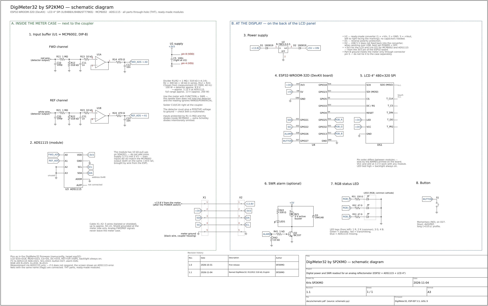

# DigiMeter32 by SP2KMO

**English** | [Polski](README.pl.md)

A digital power and SWR readout for an analog reflectometer with diode
detectors (1.8–200 MHz). The DC voltages from the FWD and REF detectors go
through an MCP6002 buffer into a 16-bit ADS1115 converter, and an ESP32 shows
forward and reflected power, SWR, return loss and PEP on a 4" SPI colour
display. The meter's analog needle keeps working unchanged.



## Files

| File | Contents |
|---|---|
| [`docs/schematic.pdf`](docs/schematic.pdf) | schematic diagram, A3 sheet (for printing) |
| [`docs/schematic.svg`](docs/schematic.svg) | the same as vector graphics |
| [`docs/schematic.png`](docs/schematic.png) | preview |
| [`docs/schematic.py`](docs/schematic.py) | schematic source (Python + [schemdraw](https://schemdraw.readthedocs.io)) |

To regenerate the schematic:

```
pip install schemdraw matplotlib
python3 docs/schematic.py schematic svg      # or: schematic pdf, schematic png
```

## Construction — two parts

**A. Inside the meter case (next to the coupler):** MCP6002 buffer, ADS1115
and connector X1. The analog FWD/REF signals never leave the metal case.

**B. At the display (on the back of the LCD panel):** R-78E5.0-0.5 converter,
ESP32-WROOM-32D (DevKit), LCD, button, RGB status LED, optional SWR alarm and
connector X2.

Cable X1–X2 (5 wires, shield grounded at the meter side only):

| Pin | Signal |
|---|---|
| 1 | +13.8 V (from the meter, after the POWER switch) |
| 2 | +3V3 (from the ESP32 to MCP6002 and ADS1115) |
| 3 | SDA |
| 4 | SCL |
| 5 | GND |

## Signal path (each channel)

Detector output → C10 100 pF to ground (right at the coupler) → divider
R11 1 MΩ / R12 318 kΩ (÷4.14) → C11 1 nF → R13 10 kΩ → MCP6002 follower →
R14 470 Ω / C12 10 nF → ADS1115 (FWD → A0, REF → A1, A2/A3 to ground).

- The divider was chosen from measurement: at 100 W the detector gives about
  8.9 V, i.e. about 2.15 V at the ADS1115; the range ends at about 13 V on the
  detector (about 200 W). For another meter: `R2 = 1 MΩ · 3 V / (U_max − 3 V)`,
  with R12 = R22.
- The input is protected by the 1 MΩ resistor alone (microamps into the
  MCP6002's internal diodes). External Schottky diodes are omitted on purpose —
  their leakage through 1 MΩ would cause a large error.
- The detector must give a **positive** voltage to ground.
- Measure with the meter's function switch in the **SWR** position — the needle
  then does not load the detector and the reading does not depend on the other switches.

## Parts list (all through-hole, THT; ready-made modules)

| Ref. | Part | Qty |
|---|---|---|
| U1 | MCP6002-I/P (DIP-8) + socket | 1 |
| U2 | Recom R-78E5.0-0.5 (7–28 V → 5 V) | 1 |
| U3 | ADS1115 module (I²C, address 0x48) | 1 |
| U4 | ESP32-WROOM-32D DevKit | 1 |
| DS1 | LCD 4" 480×320 SPI (ILI9488 / ILI9486 / ST7796S) | 1 |
| R11, R21 | 1 MΩ | 2 |
| R12, R22 | 318 kΩ (300 kΩ + 18 kΩ in series) | 2 |
| R13, R23 | 10 kΩ | 2 |
| R14, R24 | 470 Ω | 2 |
| C10, C20 | 100 pF ceramic | 2 |
| C11, C21 | 1 nF ceramic | 2 |
| C12, C22 | 10 nF ceramic | 2 |
| C5 | 100 nF ceramic (at U1) | 1 |
| D1, D2 | 1N5819 | 2 |
| S1 | momentary NO push button (illuminated — optional) | 1 |
| LED2 | 5 mm RGB LED, common cathode | 1 |
| R51 / R52, R53 | 150 Ω / 47 Ω | 1 / 2 |
| Q2, D3, R41–R43, LED1, BZ1 | SWR alarm: BC337, 1N4148, 1 kΩ, 10 kΩ, 330 Ω, LED, 5 V buzzer — optional | 1 set |

## ESP32-WROOM-32D connections

| Signal | Pin |
|---|---|
| LCD SCK / SDI (MOSI) / CS / DC / RESET | D18 / D23 / D5 / D33 / D4 |
| LCD LED | 3V3, always on |
| ADS1115 SDA / SCL | D21 / D22 |
| Button (to GND) | D27 — short: AVG/PEP, long: profile |
| SWR alarm (optional) | D26 |
| RGB LED R / G / B | D25 / D32 / D13 |
| 5 V from R-78E | VIN (via D2) |

RGB LED: green — standby, red — transmitting, blue — ADS1115 missing.

## Measurement notes

With an IC-7000 into a dummy load, the coupler of the tested meter has
practically the same sensitivity at 10 W from 80 to 6 m (±2 %), so one
calibration curve is enough for HF. On 80 m the meter itself puts an SWR of
about 1.6 into the line, and on 160 m over 3 (the radio folds back its power).
This is a property of that meter's coupler on the lowest bands, not of the
modification — the buffer sits after the detectors, outside the RF path.

## Author

Kris SP2KMO · schematic revision 1.1 (2026-11-04)
