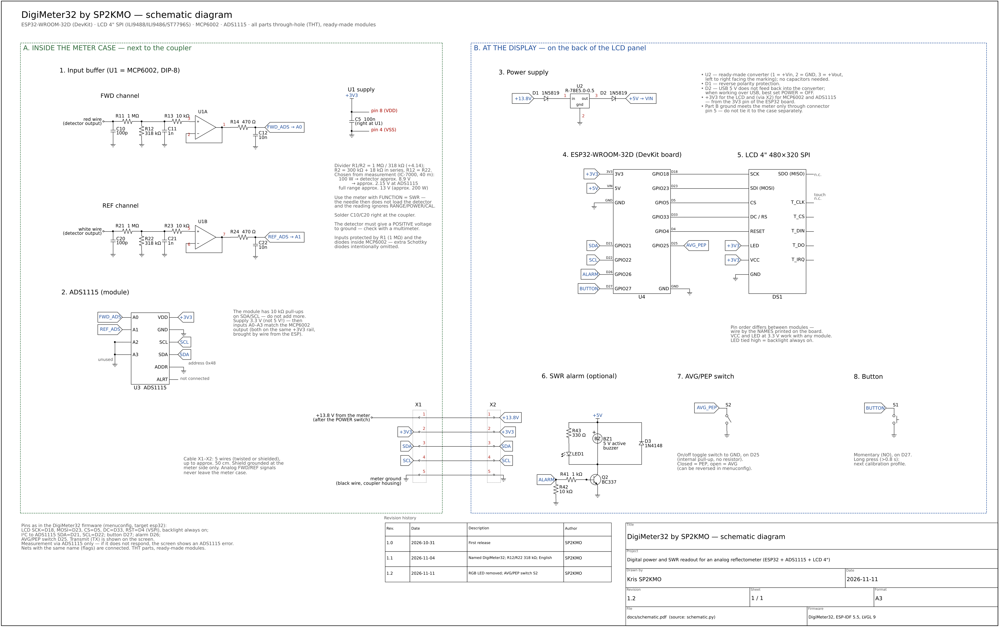
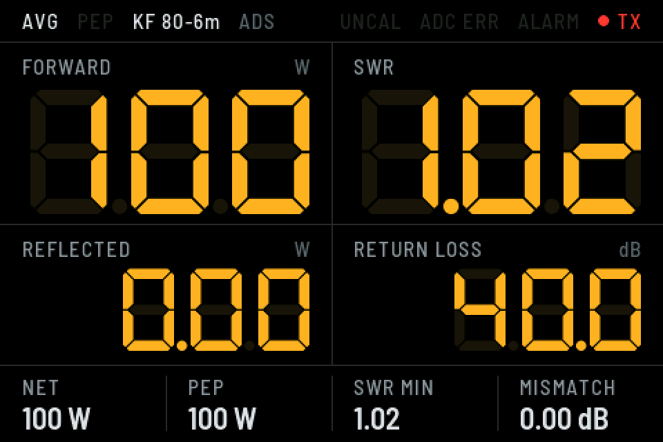

# DigiMeter32 by SP2KMO

[English](README.md) | **Polski**

Cyfrowy odczyt mocy i SWR do analogowego reflektometru z detektorami diodowymi
(1,8–200 MHz). Napięcia stałe z detektorów FWD i REF trafiają przez bufor
MCP6002 do 16-bitowego przetwornika ADS1115, a ESP32 pokazuje moc padającą,
odbitą, SWR, tłumienie odbicia i PEP na kolorowym wyświetlaczu 4" SPI.
Analogowa wskazówka miernika działa dalej bez zmian.



## Pliki

| Plik | Zawartość |
|---|---|
| [`docs/schematic.pdf`](docs/schematic.pdf) | schemat ideowy, arkusz A3 (do druku; opisy po angielsku) |
| [`docs/schematic.svg`](docs/schematic.svg) | to samo w grafice wektorowej |
| [`docs/schematic.png`](docs/schematic.png) | podgląd |
| [`docs/schematic.py`](docs/schematic.py) | źródło schematu (Python + [schemdraw](https://schemdraw.readthedocs.io)) |
| [`docs/screen.png`](docs/screen.png) | podgląd ekranu |
| [`firmware/`](firmware/) | firmware ESP32 (ESP-IDF) |

Ponowne wygenerowanie schematu:

```
pip install schemdraw matplotlib
python3 docs/schematic.py schematic svg      # albo: schematic pdf, schematic png
```

## Firmware

ESP-IDF 5.5 + LVGL 9, w katalogu [`firmware/`](firmware/) — kompilacja,
ekran, kalibracja i polecenia konsoli opisane są w [`firmware/README.md`](firmware/README.md).



- Pomiar wyłącznie przez ADS1115; gdy go brak, na ekranie świeci **ADC ERR**,
  a firmware co sekundę ponawia wykrywanie.
- Wbudowana kalibracja z pomiarów autora (KF 80–6 m, 160 m) i 4 profile
  kalibracji; każde pasmo można skalibrować jednym punktem znanej mocy
  (`profile copy`, `cal scale`).
- AVG/PEP wybiera przełącznik włącz/wyłącz (D25 do masy: zwarty = PEP).
  Przycisk chwilowy: długo — następny profil. Nadawanie widać jako **TX**
  w prawym górnym rogu ekranu.

```
cd firmware
idf.py set-target esp32
idf.py build flash monitor
```

## Budowa — dwie części

**A. W obudowie miernika (przy sprzęgaczu):** bufor MCP6002, ADS1115 i złącze X1.
Analogowe sygnały FWD/REF nie wychodzą poza metalową obudowę miernika.

**B. Przy wyświetlaczu (z tyłu panelu LCD):** przetwornica R-78E5.0-0.5,
ESP32-WROOM-32D (DevKit), LCD, przycisk, przełącznik AVG/PEP, opcjonalny alarm SWR i złącze X2.

Przewód X1–X2 (5 żył, ekran do masy tylko po stronie miernika):

| Pin | Sygnał |
|---|---|
| 1 | +13,8 V (z miernika, za wyłącznikiem POWER) |
| 2 | +3V3 (z ESP32 do MCP6002 i ADS1115) |
| 3 | SDA |
| 4 | SCL |
| 5 | GND |

## Tor pomiarowy (każdy kanał)

Wyjście detektora → C10 100 pF do masy (przy samym sprzęgaczu) → dzielnik
R11 1 MΩ / R12 318 kΩ (÷4,14) → C11 1 nF → R13 10 kΩ → wtórnik MCP6002 →
R14 470 Ω / C12 10 nF → ADS1115 (FWD → A0, REF → A1, A2/A3 do masy).

- Dzielnik dobrany z pomiaru: przy 100 W detektor daje ok. 8,9 V, czyli ok. 2,15 V
  na ADS1115; zakres kończy się przy ok. 13 V na detektorze (ok. 200 W).
  Dla innego miernika: `R2 = 1 MΩ · 3 V / (U_max − 3 V)`, R12 = R22.
- Wejście chroni sam rezystor 1 MΩ (mikroampery do wewnętrznych diod MCP6002).
  Zewnętrzne diody Schottky'ego celowo pominięte — ich upływ na 1 MΩ dawałby duży błąd.
- Detektor musi dawać napięcie **dodatnie** względem masy.
- Mierzyć z przełącznikiem funkcji miernika w pozycji **SWR** — wtedy wskazówka
  nie obciąża detektora i odczyt nie zależy od pozostałych przełączników.

## Lista części (wszystko przewlekane, THT; moduły gotowe)

| Oznaczenie | Część | Ilość |
|---|---|---|
| U1 | MCP6002-I/P (DIP-8) + podstawka | 1 |
| U2 | Recom R-78E5.0-0.5 (7–28 V → 5 V) | 1 |
| U3 | moduł ADS1115 (I²C, adres 0x48) | 1 |
| U4 | ESP32-WROOM-32D DevKit | 1 |
| DS1 | LCD 4" 480×320 SPI (ILI9488 / ILI9486 / ST7796S) | 1 |
| R11, R21 | 1 MΩ | 2 |
| R12, R22 | 318 kΩ (300 kΩ + 18 kΩ szeregowo) | 2 |
| R13, R23 | 10 kΩ | 2 |
| R14, R24 | 470 Ω | 2 |
| C10, C20 | 100 pF ceramiczny | 2 |
| C11, C21 | 1 nF ceramiczny | 2 |
| C12, C22 | 10 nF ceramiczny | 2 |
| C5 | 100 nF ceramiczny (przy U1) | 1 |
| D1, D2 | 1N5819 | 2 |
| S1 | przycisk chwilowy NO (z podświetleniem — opcja) | 1 |
| S2 | przełącznik włącz/wyłącz (SPST) — AVG/PEP | 1 |
| Q2, D3, R41–R43, LED1, BZ1 | alarm SWR: BC337, 1N4148, 1 kΩ, 10 kΩ, 330 Ω, LED, buzzer 5 V — opcja | 1 kpl. |

## Połączenia ESP32-WROOM-32D

| Sygnał | Pin |
|---|---|
| LCD SCK / SDI (MOSI) / CS / DC / RESET | D18 / D23 / D5 / D33 / D4 |
| LCD LED | 3V3 na stałe |
| ADS1115 SDA / SCL | D21 / D22 |
| Przycisk S1 (do GND) | D27 — długo: następny profil |
| Alarm SWR (opcja) | D26 |
| Przełącznik AVG/PEP S2 (do GND) | D25 — zwarty: PEP, rozwarty: AVG |
| Zasilanie 5 V z R-78E | VIN (przez D2) |

Nadawanie i błędy widać na ekranie (**TX**, **ADC ERR**); dioda stanu nie jest używana.

## Uwagi z pomiarów

Sprzęgacz testowanego miernika (IC-7000, sztuczne obciążenie) ma przy 10 W
praktycznie tę samą czułość od 80 do 6 m (±2 %), więc wystarcza jedna krzywa
kalibracji na KF. Na 80 m miernik wprowadza w linię SWR ok. 1,6, a na 160 m
ponad 3 (radio obcina moc) — to cecha sprzęgacza tego miernika na najniższych
pasmach, nie przeróbki, bo bufor jest za detektorami, poza torem w.cz.

## Autor

Kris SP2KMO · rewizja schematu 1.2 (2026-11-11)
