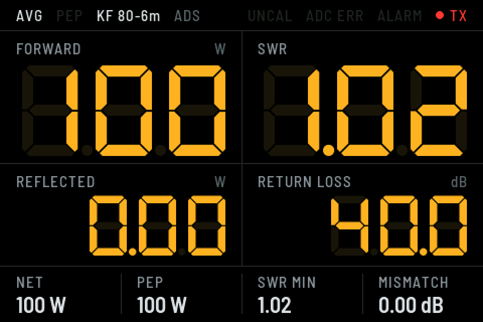

# DigiMeter32 — firmware

Firmware cyfrowego odczytu mocy i SWR dla analogowego reflektometru z
detektorami diodowymi. ESP32 (WROOM-32D; działa też na ESP32-C6) czyta przez
ADS1115 napięcia z obu detektorów (FWD i REF), przelicza je na moc według
krzywej kalibracji i pokazuje wynik na wyświetlaczu 4" 480×320 (SPI).
Wskazówka analogowa działa dalej — elektronika tylko „podsłuchuje” detektory
przez bufor o dużej impedancji.

Schemat, lista części i połączenia: [README projektu](../README.pl.md),
[`docs/schematic.pdf`](../docs/schematic.pdf).



---

## Co pokazuje ekran

| Miejsce | Zawartość |
|---|---|
| Pasek górny, z lewej | tryb **AVG / PEP** (zapalony aktywny), nazwa profilu kalibracji, źródło pomiaru (**ADS**) |
| Pasek górny, z prawej | **UNCAL** — profil bez kalibracji, **ADC ERR** — brak ADS1115 albo brak danych z niego, **ALARM** — SWR ponad próg, lampka i **TX** — nadawanie |
| **FORWARD** | moc padająca [W] |
| **SWR** | współczynnik fali stojącej; po zakończeniu nadawania ostatnia wartość zostaje przygaszona, czerwony = alarm |
| **REFLECTED** | moc odbita [W] |
| **RETURN LOSS** | tłumienie odbicia [dB] |
| Pasek dolny | **NET** — moc netto do anteny, **PEP/AVG** — druga z wartości (inna niż wybrany tryb), **SWR MIN** — najniższy SWR w bieżącym nadawaniu (przy strojeniu anteny), **MISMATCH** — straty niedopasowania [dB] |

Odczyty siedmiosegmentowe mają wygaszone segmenty w tle, jak w wyświetlaczu
LCD przyrządu.

**Przycisk** (D27, zewnętrzny do GND): krótko — AVG ↔ PEP; długo (> 0,8 s) —
następny profil kalibracji (1 → 2 → 3 → 4 → 1). Profil i tryb zapisują się w pamięci.

**Dioda RGB** (opcja, wspólna katoda; R → 150 Ω → D25, G → 47 Ω → D32,
B → 47 Ω → D13): **zielony** — gotowość, **czerwony** — nadawanie,
**niebieski** — brak ADS1115 albo brak danych z niego (np. przerwa w przewodzie X1–X2).

---

## Kompilacja

Wymaga **ESP-IDF 5.5** lub nowszego (sprawdzone na v5.5.6). LVGL 9 pobiera
się automatycznie przez menedżer komponentów.

```bash
. $HOME/esp/esp-idf/export.sh
cd firmware
idf.py set-target esp32        # albo esp32c6
idf.py menuconfig              # DigiMeter32 → sterownik LCD, piny, dzielnik
idf.py build flash monitor
```

Konsola działa na gnieździe USB płytki ESP32 (115200 b/s).

Czcionki ekranu (`main/fonts/`) są wygenerowane skryptem
[`tools/gen_lvgl_font.py`](tools/gen_lvgl_font.py) z DSEG7 Classic Bold
i Barlow Semi Condensed (obie na licencji SIL OFL 1.1).

### Ustawienia w `menuconfig` → *DigiMeter32*

* **Wyświetlacz LCD** — sterownik ILI9488 / ILI9486 / ILI9486 typu RPi /
  ST7796S, zegar SPI (domyślnie 40 MHz), obrót, BGR, inwersja, piny.
* **Pomiar** — źródło (domyślnie *tylko ADS1115*), piny I²C, adres, wejścia
  ADS1115, **dzielnik wejściowy** (R11 = 1 MΩ, R12 = 318,5 kΩ), fabryczna
  kalibracja, model przed kalibracją (2,14 V = 100 W).
* **Sterowanie** — przycisk, wyjście alarmu, dioda RGB.

### Pomiar przez ADS1115

Domyślnie firmware mierzy **tylko przez ADS1115**. Gdy moduł nie odpowiada,
świeci się **ADC ERR**, odczyty spadają do zera, alarm się wyłącza, a firmware
co sekundę ponawia wykrywanie — po poprawieniu połączenia pomiar wraca sam.

ADS1115 ma 16 bitów i dobiera wzmocnienie osobno dla każdego kanału (aż do
±0,256 V, ok. 8 µV na krok), więc mierzy też bardzo małe napięcie REF przy
dobrym SWR. Wbudowany przetwornik ESP32 nadal jest w kodzie (`set adc int`
albo `auto`), ale w tym projekcie nie jest podłączony.

---

## Kalibracja

### Fabryczna kalibracja

Firmware ma wpisaną kalibrację z pomiarów SP2KMO (IC-7000, sztuczne
obciążenie, miernik w pozycji FUNCTION = SWR). Wczytuje się przy pierwszym
uruchomieniu i po `defaults yes`.

| Profil | Nazwa | Krzywa |
|---|---|---|
| 1 | KF 80-6m | 5 punktów z 40 m (5 / 10 / 25 / 50 / 100 W) |
| 2 | 160m | krzywa z 40 m × 0,831 (wg punktu 10 W) — orientacyjna, patrz niżej |
| 3 | 2m | pusta (UNCAL) |
| 4 | P4 | pusta |

Napięcia zmierzone multimetrem na przewodach detektora przeliczane są na
napięcia na ADS1115 przez dzielnik z `menuconfig`. Tolerancja rezystorów daje
ok. 2 % błędu mocy — dla dokładności powtórz kalibrację na miejscu (niżej).

#### Pomiary na pasmach (napięcie FWD na przewodzie detektora)

| kHz | 5 W | 10 W | 25 W | 50 W | 100 W |
|---|---|---|---|---|---|
| 50313 | | 2,19 | | 5,89 | 8,24 |
| 28074 | | 2,21 | | 6,03 | 8,40 |
| 21074 | | 2,24 | | 6,08 | 9,02 |
| 14074 | | 2,21 | | 6,03 | 8,92 |
| 7074 | 1,48 | 2,19 | 4,24 | 6,03 | 8,87 |
| 3573 | | 2,15 | | 5,68 | 8,42 |
| 1840 | | 1,82 | | 4,00 | 4,97 |

Od 80 do 6 m czułość sprzęgacza przy 10 W różni się o ±2 %, więc wystarcza
jedna krzywa. Różnice przy 100 W idą w parze ze stosunkiem U100/U10, więc to
najpewniej różna moc wyjściowa radia na pasmach, a nie sprzęgacz.

Na 160 m radio prosto na sztuczne obciążenie ma SWR 1,01, a z miernikiem
w linii ponad 3 (i obcina moc do ok. 50 %); na 80 m ok. 1,6. Niedopasowanie
wprowadza sprzęgacz miernika na najniższych pasmach — nie przeróbka (bufor
jest za detektorami, poza torem w.cz.). Na 160 m najlepiej nadawać
z miernikiem wyjętym z linii; na 80 m odczyt SWR jest zawyżony.

Detektor jest nieliniowy (10× większa moc daje 4,3× większe napięcie zamiast
3,2×), dlatego kalibracja jest kilkupunktowa.

### Kalibracja na miejscu

Połącz się z konsolą (`idf.py monitor` albo dowolny terminal szeregowy,
115200 b/s) i wpisz `help`. Ustawienia zapisują się od razu w pamięci flash.

**1. Zero** — bez nadawania:

```
dm32> zero
```

**2. Punkty FWD** — miernik na **FUNCTION = SWR**, nadawanie **nośnej**
(FM, CW lub AM bez modulacji — nie SSB) na sztuczne obciążenie 50 Ω:

```
dm32> profile 1
dm32> cal fwd 5
dm32> cal fwd 10
dm32> cal fwd 25
dm32> cal fwd 50
dm32> cal fwd 100
```

Liczba po `cal fwd` to moc w watach, którą właśnie nadajesz; napięcie
firmware mierzy sam (2 s). Wystarczy 4–8 punktów, koniecznie jeden przy małej
mocy. Dokładność zależy od tego, jak dobrze znasz moc — najlepiej sprawdzić ją
sondą diodową na sztucznym obciążeniu: `P ≈ (U + 0,4)² / 100` przy ok. 10 W.

**3. Inne pasmo jednym punktem** — kształt krzywej jest na każdym paśmie
taki sam, zmienia się tylko czułość sprzęgacza:

```
dm32> profile copy 1 3
dm32> profile 3 name 2m
dm32> profile 3
dm32> cal scale 10        (nadaj 10 W nośnej)
```

**4. Punkty REF (opcjonalnie)** — gdy tabela REF jest pusta, używana jest
tabela FWD (sprzęgacz jest symetryczny), więc ten krok można pominąć.

**5. Sprawdzenie i kopia:**

```
dm32> status       # napięcia, moce, SWR
dm32> cal          # lista punktów
dm32> export       # wszystkie ustawienia jako polecenia — zapisz do pliku
```

Wynik `export` można wkleić z powrotem do konsoli.

### Wszystkie polecenia

| Polecenie | Działanie |
|---|---|
| `status` | bieżące napięcia, moce i SWR |
| `zero` | zapamiętaj napięcia spoczynkowe |
| `cal` | lista punktów aktywnego profilu |
| `cal fwd <W>` / `cal ref <W>` | dodaj punkt z bieżącego pomiaru |
| `cal set fwd\|ref <V> <W>` | wpisz punkt ręcznie (V na wejściu ADS1115) |
| `cal del fwd\|ref <n>` | usuń punkt |
| `cal clear fwd\|ref\|all` | wyczyść tabelę |
| `cal scale <W>` | nadaj znaną moc — cała krzywa aktywnego profilu przeskaluje się tak, żeby ten punkt się zgadzał |
| `profile`, `profile <n>`, `profile <n> name X` | profile kalibracji |
| `profile copy <z> <do>` | skopiuj kalibrację między profilami (nazwa docelowa zostaje) |
| `set` | pokaż ustawienia |
| `set mode avg\|pep` | tryb wyświetlania |
| `set minpwr <W>` | próg wykrycia nadawania (domyślnie 0,5 W) |
| `set alarm <SWR>` | próg alarmu (domyślnie 3,0) |
| `set hold <ms>` | podtrzymanie wartości szczytowej (domyślnie 1500) |
| `set smooth <0–0,95>` | uśrednianie w trybie AVG (domyślnie 0,6) |
| `set bl <5–100>` | jasność podświetlenia (tylko gdy podświetlenie jest na GPIO) |
| `set adc ads\|auto\|int` | źródło pomiaru (restart); domyślnie `ads` |
| `set fs <V> <W>` | model przed kalibracją: napięcie na ADS przy pełnej skali |
| `stream <ms>` / `stream off` | strumień CSV (do arkusza / wykresu) |
| `export` | kopia ustawień jako polecenia |
| `defaults yes` | ustawienia fabryczne (z fabryczną kalibracją) |
| `restart` | restart |

---

## Jak to liczy

Detektor diodowy daje napięcie w przybliżeniu proporcjonalne do amplitudy
sygnału w.cz., czyli do √P — z wyjątkiem małych mocy, gdzie dioda jeszcze nie
przewodzi w pełni. Firmware interpoluje liniowo w przestrzeni (U, √P) pomiędzy
punktami kalibracji, a powyżej ostatniego punktu ekstrapoluje nachyleniem
ostatniego odcinka.

```
ρ = √(P_ref / P_fwd)        SWR = (1 + ρ) / (1 − ρ)
RL = −20·log10(ρ) dB        ML = −10·log10(1 − ρ²) dB
```

Pomiar odbywa się w ramkach co 20 ms. **AVG** to wygładzona średnia, **PEP**
to maksimum z podtrzymaniem i powolnym opadaniem — właściwe dla SSB.
SWR nie jest liczony, gdy moc padająca jest poniżej progu `minpwr`.

Konfiguracja w pamięci NVS jest sprawdzana przy starcie — pola spoza zakresu
i niespójne tabele kalibracji są zastępowane wartościami domyślnymi.

---

## Struktura

```
main/
  main.c                start: NVS, ekran, pomiar, przycisk, dioda RGB, konsola
  lcd_ili948x.c         sterownik SPI: ILI9488 / ILI9486 / ILI9486-RPi / ST7796S
  display.c             integracja LVGL (bufory, flush przez DMA, zadanie LVGL)
  ui.c                  ekran pomiarowy (odczyty 7-segmentowe)
  fonts/                czcionki ekranu (wygenerowane)
  meas.c                przetwarzanie: zero, kalibracja, AVG/PEP, SWR, alarm
  meas_ads1115.c        ADS1115 z automatycznym wzmocnieniem
  meas_adc_internal.c   wbudowany ADC (nieużywany w tym projekcie)
  calib.c               krzywa detektora, SWR, skalowanie krzywej
  app_config.c          ustawienia i kalibracja w NVS (z fabryczną kalibracją)
  console_cmds.c        polecenia konsoli
  button.c              przycisk AVG/PEP i profil
  status_led.c          dioda RGB stanu
tools/gen_lvgl_font.py  generator czcionek LVGL
```
